# hcp-graph-targeting: demo video audit report

**Repository:** https://github.com/kavya2693/hcp-graph-targeting  
**Numbers taken from commit:** `719ffbf` (outputs last changed in `719ffbf (2026-10-13 21:46:05 +0400)`)  
**Video:** `docs/demo/demo.mp4` (90.4 s, 1920x1080, 30 fps, silent)  
**Generated:** 2026-10-14 18:43  
**Automated checks:** 56 pass · 0 fail · 3 manual (of 59 figures)

## How to use this report

Every number or claim on screen has an ID (`F-01`, `F-02`, ...) and every modelling assumption has an ID (`A-01`, ...). Cite the ID. Each figure lists its source file, the exact column/row/key, the formula for derived numbers, and an automated check result. The change-impact matrix tells you which slides and files change if an input or assumption changes.

Types: **direct** = read straight from a repo output; **derived** = computed from direct values (formula given); **illustrative** = drawing or example, not data; **general knowledge** = context not produced by the repo.

### Regenerate

```bash
make run                                   # data/ + outputs/ablation.csv, deltas.csv, feature_importance.csv, summary.json
uv run python scripts/seed_sweep.py        # outputs/seed_sweep.csv/.txt (seeds 11, 23)
.venv/bin/python docs/demo/source/tools/export_call_plan.py docs/demo/source/assets/call_plan.json   # ~30 s; asserts AUC + captured match ablation.csv
python3 docs/demo/source/tools/inject_sheet.py docs/demo/source/assets/call_plan.json docs/demo/source/compositions --rows 1,2,3,4,5,6
cd docs/demo/source && npx --yes hyperframes@0.8.156 check && npx --yes hyperframes@0.8.156 render -f 30 -q looks -o renders/hcp-graph-targeting-master.mp4 && cd -
ffmpeg -y -i docs/demo/source/renders/hcp-graph-targeting-master.mp4 -c:v libx264 -preset slow -crf 25 -pix_fmt yuv420p -movflags +faststart -an docs/demo/demo.mp4
python3 docs/demo/source/tools/build_audit_report.py docs/demo/source/audit/facts.yaml   # stills, checks, MD/DOCX/PDF
```

## 1. Figures

| ID | Shown on screen | Slides | Source | Column / row / key | How computed | Type | Check |
|---|---|---|---|---|---|---|---|
| F-01 | 3 industry chips | 01 | `author's framing` | - | - | general knowledge | manual: Context statement, not a repo output. |
| F-02 | 4 problem cards | 01 | `README 'The problem'` | README lines 11-26 | - | general knowledge | ✓ verified |
| F-03 | 20,000 doctors / 20,000 HCPs | 02, 05, 07, 10 | `outputs/summary.json` | n_hcps | - | direct | ✓ verified |
| F-04 | 75,155 ties | 02, 05 | `outputs/summary.json; data/edges.csv` | n_edges | - | direct | ✓ verified |
| F-05 | Calls for just 1 in 20 | 02 | `outputs/summary.json` | budgets.captured_5pct = 1,000; n_hcps = 20,000 | 20,000 / 1,000 = 20 | derived | ✓ verified |
| F-06 | 8 specialties · 12 regions | 02 | `data/hcps.csv` | specialty, region (distinct values) | - | direct | ✓ verified |
| F-07 | 24 months of class prescriptions | 02, 05 | `data/monthly_class_rx.csv` | month columns (2024-07..2026-06) | columns - hcp_id | direct | ✓ verified |
| F-08 | only 8.1% convert to the new drug / all 20,000: 8.1% | 02, 06 | `outputs/summary.json` | conversion_rate = 0.08085 (1,617 of 20,000) | rounded to 1 decimal | direct | ✓ verified |
| F-09 | PRACTICES · groups of about 50 | 03 | `outputs/summary.json; README line 161` | communities_per_level[1] = 408 | 20,000 / 408 = 49 | derived | ✓ verified |
| F-10 | 5 TEST ROUNDS / 5 test rounds / the model is tested 5 times | 03, 05 | `outputs/summary.json` | folds | - | direct | ✓ verified |
| F-11 | more converters · shuffle-tested · leak-tested | 03 | `outputs/ablation.csv; tests/test_leakage.py` | captured_5pct graph features > decile list; control rows present; leakage tests exist | 189 > 126 | derived | ✓ verified |
| F-12 | Leaky first version: 0.589 | 04 | `docs/adr/0001-graph-features-built-fold-safe-embeddings-label-free.md:17` | ADR text | - | direct | ✓ verified |
| F-13 | 0.668 | 04, 08 | `outputs/ablation.csv` | arm='+ community and neighbour conversion rates', auc | - | direct | ✓ verified |
| F-15 | PRACTICE RATE 2 / 5 | 04 | `schematic` | - | - | illustrative | manual: Illustrative drawing of features.py label_graph_features; not real HCPs. |
| F-16 | generate(), profile_features(), louvain_communities(), structural_features(), label_graph_features(), node2vec, GraphSAGE, make_folds(), run_arm(), captured_at_budget(), summarise(), bootstrap_delta(), cli.py shuffled control | 05 | `src/hcp_targeting/` | def names | - | direct | ✓ verified |
| F-17 | 35 regions · 408 groups | 05 | `outputs/summary.json` | communities_per_level | - | direct | ✓ verified |
| F-19 | 400 trees · depth 4 | 05 | `src/hcp_targeting/evaluate.py:88-90` | n_estimators, max_depth | - | direct | ✓ verified |
| F-20 | nine model variants · 7 feature sets + 2 controls · 45 fits | 05 | `src/hcp_targeting/evaluate.py (ARMS); cli.py:98 (ARMS[2], ARMS[5]); outputs/ablation.csv` | 7 Arm(...) + 2 control rows | (7 + 2) x 5 folds = 45 | derived | ✓ verified |
| F-21 | 32-d walks · 2 × SAGEConv | 05 | `src/hcp_targeting/cli.py:197; embeddings.py:131-133` | --dim 32; conv1, conv2 = SAGEConv | - | direct | ✓ verified |
| F-22 | 1,000 or 4,000 calls | 05 | `outputs/summary.json` | budgets | - | direct | ✓ verified |
| F-23 | 200 resamples · 95% range / 95% ranges from 200 resamples | 05, 08 | `src/hcp_targeting/cli.py:201; evaluate.py:52` | --n-boot default 200; percentiles 2.5/97.5 | - | direct | ✓ verified |
| F-24 | full run ≈ 403 s · 10-core laptop | 05 | `README line 178` | README text | - | direct | ✓ verified |
| F-25 | one command runs it all on a CPU / RUNS ON A LAPTOP CPU | 05, 10 | `README 'Running it'` | README text | - | direct | ✓ verified |
| F-26 | fallback: today's decile list | 05 | `src/hcp_targeting/cli.py:83-84` | rule = decile * 1e6 + annual_class_rx | - | direct | ✓ verified |
| F-27 | practice + peers · no own label · train labels only | 05 | `src/hcp_targeting/features.py:153-184; tests/test_leakage.py` | inner_folds = 5 | - | direct | ✓ verified |
| F-28 | generate() · seed 7 | 05 | `outputs/summary.json` | seed | - | direct | ✓ verified |
| F-29 | 590 of 1,834 doctors in one region · 1,304 ties | 06 | `demo assets/call_plan.json (network_sample), exported by tools/export_call_plan.py from Louvain on data/edges.csv` | len(nodes), l0_size, len(edges) | 8 largest level-1 communities of the 5th-largest level-0 block | direct | ✓ verified |
| F-30 | 9 of 59 15.3% · 7 of 68 10.3% · 6 of 60 10.0% · 4 of 64 6.2% · 4 of 87 4.6% · 4 of 97 4.1% · 2 of 78 2.6% · 2 of 79 2.5% | 06 | `demo assets/call_plan.json (network_sample.communities); labels from data/hcps.csv converted` | converted, size, rate | rate = converted / size | direct | ✓ verified |
| F-31 | ● converted · ● not yet | 06 | `data/hcps.csv; demo assets/call_plan.json` | converted per hcp_id | - | direct | ✓ verified |
| F-32 | 126 · 0.623 | 06 | `outputs/ablation.csv` | arm='decile list (no model)': captured_5pct, auc | - | direct | ✓ verified |
| F-33 | 166 · 0.641 | 06 | `outputs/ablation.csv` | captured_5pct, auc | - | direct | ✓ verified |
| F-34 | 188 · 0.658 | 06 | `outputs/ablation.csv` | captured_5pct, auc | - | direct | ✓ verified |
| F-35 | 189 · 0.668 | 06 | `outputs/ablation.csv` | captured_5pct, auc | - | direct | ✓ verified |
| F-36 | 202 · 0.676 | 06 | `outputs/ablation.csv` | captured_5pct, auc | - | direct | ✓ verified |
| F-37 | 212 · 0.674 | 06, 08 | `outputs/ablation.csv` | captured_5pct, auc | - | direct | ✓ verified |
| F-38 | 146 · 0.633 | 06, 08 | `outputs/ablation.csv` | arm='control, HCPs shuffled across the graph: + community and neighbour conversion rates' | - | direct | ✓ verified |
| F-39 | 322 · 0.761 | 06, 08 | `outputs/ablation.csv` | arm='ceiling: true propensity (answer key)' | - | direct | ✓ verified |
| F-40 | #1 Dr 16728 … #6 Dr 04338 | 07 | `demo assets/call_plan.json, injected into compositions/value.html` | plan ranks 1-6 | score = out-of-fold p(convert); practice rate = fold-built community_conv_rate_l1 as the HCP saw it when held out; PEERS SWITCHED = nbr_converted | direct | ✓ verified |
| F-41 | + 994 more | 07 | `demo assets/call_plan.json` | calls - 6 rows | 1,000 - 6 = 994 | derived | ✓ verified |
| F-42 | 848 of the 1,000 are not in the decile list's top 1,000 | 07 | `demo assets/call_plan.json` | plan[].decile_rank > 1,000 | count | derived | ✓ verified |
| F-43 | 1,000 calls · 189 converters reached · decile list: 126 | 07 | `demo assets/call_plan.json; outputs/ablation.csv` | captured, captured_decile_list (equal to ablation.csv captured_5pct) | - | direct | ✓ verified |
| F-44 | 29 of 100 doctors here on the plan · called: 29 · switched: 6 | 07 | `demo assets/call_plan.json (scene)` | size, planned, planned_converted | - | direct | ✓ verified |
| F-45 | TOP 1,000 OF 20,000 DOCTORS | 07 | `demo assets/call_plan.json` | calls, n_hcps | - | direct | ✓ verified |
| F-46 | +50% · decile list 126 → 189 | 08 | `outputs/ablation.csv` | captured_5pct: graph features 189, decile list 126 | 189 / 126 - 1 = +50.0% | derived | ✓ verified |
| F-47 | 0.641 → 0.668 · range +0.018 to +0.037 | 08 | `outputs/deltas.csv` | arm='+ community and neighbour conversion rates', vs='profile + decile', metric=auc | - | direct | ✓ verified |
| F-48 | 0.633 · below no-network 0.641 | 08 | `outputs/ablation.csv` | both control rows auc; profile + decile auc | - | direct | ✓ verified |
| F-49 | 44% · 126 → 212, max 322 | 08 | `outputs/ablation.csv` | captured_5pct: decile 126, best (n2v + SAGE) 212, ceiling 322 | (212 - 126) / (322 - 126) = 43.9% | derived | ✓ verified |
| F-50 | +0.025 to +0.039 AUC | 08 | `outputs/seed_sweep.csv` | auc: 'graph features' minus 'profile' per seed (7, 11, 23) | min/max of 0.0269, 0.0247, 0.0388 | derived | ✓ verified |
| F-51 | Graph features vs no network +0.027 (line +0.018 to +0.037) LIFT | 09 | `outputs/deltas.csv` | arm='+ community and neighbour conversion rates', vs='profile + decile', auc | - | direct | ✓ verified |
| F-52 | +0.008 (range touches zero) | 09 | `outputs/deltas.csv` | arm='graph features + node2vec', vs='graph features', auc | - | direct | ✓ verified |
| F-53 | -0.002 | 09 | `outputs/deltas.csv` | arm='graph features + GraphSAGE', vs='graph features', auc | - | direct | ✓ verified |
| F-56 | 40% TRAP · 23% · 21% | 09 | `outputs/summary.json` | gain_share_by_block_full_model: node2vec 0.3975, structure 0.1259 + label_graph 0.1049, graphsage 0.2091 | graph features = 0.1259 + 0.1049 = 0.2309 | derived | ✓ verified |
| F-60 | AUC 0.641 → 0.668, 189 vs 166 converters per 1,000 calls | 09 | `outputs/ablation.csv` | auc and captured_5pct: profile + decile (XGBoost), + community and neighbour conversion rates | - | direct | ✓ verified |
| F-61 | THE FIX, IN THE REPO · Score each block by the AUC it adds | 09 | `src/hcp_targeting/cli.py:123-150 (deltas loop, bootstrap_delta); src/hcp_targeting/evaluate.py (bootstrap_delta)` | ref_name in ('profile + decile', 'graph features'); deltas.csv written | - | direct | ✓ verified |
| F-62 | NEXT supervised GraphSAGE | 09 | `README 'Insights and learning'; README 'Design decisions' (leaves a fold-safe supervised GraphSAGE untested)` | README text | - | direct | ✓ verified |
| F-63 | AUC = how well a score ranks converters (switchers) above the rest; higher is better; 0.5 = a coin flip | 04, 06, 08, 09 | `standard definition of ROC AUC` | - | - | general knowledge | manual: Plain-English definition of a standard metric; not a repo output. |
| F-57 | MIT | 10 | `LICENSE line 1` | - | - | direct | ✓ verified |
| F-58 | XGBoost · NetworkX · PyTorch Geometric · Python | 10 | `pyproject.toml dependencies` | xgboost, networkx, torch-geometric | - | direct | ✓ verified |
| F-59 | $ make run   # 20,000 doctors, 9 model variants, 5 test rounds | 10 | `Makefile; cli.py defaults` | run target; --n-hcps 20000; 7 arms + 2 controls; --folds 5 | - | direct | ✓ verified |

## 2. Automated check run (2026-10-14 18:43)

| ID | Expected on slide | Recomputed from repo | Result |
|---|---|---|---|
| F-01 | 3 industry chips | - | manual |
| F-02 | true | true | ✓ pass |
| F-03 | 20,000 | 20,000 | ✓ pass |
| F-04 | 75,155 | 75,155 | ✓ pass |
| F-05 | 1 in 20 | 1 in 20 | ✓ pass |
| F-06 | true | true | ✓ pass |
| F-07 | 24 | 24 | ✓ pass |
| F-08 | 8.1% | 8.1% | ✓ pass |
| F-09 | 49 | 49 | ✓ pass |
| F-10 | 5 | 5 | ✓ pass |
| F-11 | true | true | ✓ pass |
| F-12 | true | true | ✓ pass |
| F-13 | 0.668 | 0.668 | ✓ pass |
| F-15 | PRACTICE RATE 2 / 5 | - | manual |
| F-16 | true | true | ✓ pass |
| F-17 | 35 · 408 | 35 · 408 | ✓ pass |
| F-19 | true | true | ✓ pass |
| F-20 | 45 | 45 | ✓ pass |
| F-21 | true | true | ✓ pass |
| F-22 | 1,000 · 4,000 | 1,000 · 4,000 | ✓ pass |
| F-23 | true | true | ✓ pass |
| F-24 | true | true | ✓ pass |
| F-25 | true | true | ✓ pass |
| F-26 | true | true | ✓ pass |
| F-27 | true | true | ✓ pass |
| F-28 | 7 | 7 | ✓ pass |
| F-29 | 590 of 1,834 · 1,304 | 590 of 1,834 · 1,304 | ✓ pass |
| F-30 | 9 of 59 15.3% · 7 of 68 10.3% · 6 of 60 10.0% · 4 of 64 6.2% · 4 of 87 4.6% · 4 of 97 4.1% · 2 of 78 2.6% · 2 of 79 2.5% | 9 of 59 15.3% · 7 of 68 10.3% · 6 of 60 10.0% · 4 of 64 6.2% · 4 of 87 4.6% · 4 of 97 4.1% · 2 of 78 2.6% · 2 of 79 2.5% | ✓ pass |
| F-31 | true | true | ✓ pass |
| F-32 | 126 · 0.623 | 126 · 0.623 | ✓ pass |
| F-33 | 166 · 0.641 | 166 · 0.641 | ✓ pass |
| F-34 | 188 · 0.658 | 188 · 0.658 | ✓ pass |
| F-35 | 189 · 0.668 | 189 · 0.668 | ✓ pass |
| F-36 | 202 · 0.676 | 202 · 0.676 | ✓ pass |
| F-37 | 212 · 0.674 | 212 · 0.674 | ✓ pass |
| F-38 | 146 · 0.633 | 146 · 0.633 | ✓ pass |
| F-39 | 322 · 0.761 | 322 · 0.761 | ✓ pass |
| F-40 | true | true | ✓ pass |
| F-41 | 994 | 994 | ✓ pass |
| F-42 | 848 | 848 | ✓ pass |
| F-43 | 189 · 126 | 189 · 126 | ✓ pass |
| F-44 | 29 of 100 · 6 | 29 of 100 · 6 | ✓ pass |
| F-45 | 1,000 of 20,000 | 1,000 of 20,000 | ✓ pass |
| F-46 | +50% | +50% | ✓ pass |
| F-47 | +0.027 [+0.018, +0.037] | +0.027 [+0.018, +0.037] | ✓ pass |
| F-48 | 0.633 · 0.633 · 0.641 | 0.633 · 0.633 · 0.641 | ✓ pass |
| F-49 | 44% | 44% | ✓ pass |
| F-50 | +0.025 to +0.039 | +0.025 to +0.039 | ✓ pass |
| F-51 | +0.027 [+0.018, +0.037] | +0.027 [+0.018, +0.037] | ✓ pass |
| F-52 | +0.008 [-0.000, +0.014] | +0.008 [-0.000, +0.014] | ✓ pass |
| F-53 | -0.002 [-0.008, +0.003] | -0.002 [-0.008, +0.003] | ✓ pass |
| F-56 | 40% · 23% · 21% | 40% · 23% · 21% | ✓ pass |
| F-60 | 0.641 → 0.668, 189 vs 166 | 0.641 → 0.668, 189 vs 166 | ✓ pass |
| F-61 | true | true | ✓ pass |
| F-62 | true | true | ✓ pass |
| F-63 | AUC = how well a score ranks converters (switchers) above the rest; higher is better; 0.5 = a coin flip | - | manual |
| F-57 | true | true | ✓ pass |
| F-58 | true | true | ✓ pass |
| F-59 | true | true | ✓ pass |

## 3. Assumptions register

| ID | Assumption | Source | Used by | Sensitivity: if this changes |
|---|---|---|---|---|
| A-01 | All data is synthetic, produced by a seeded generator (20,000 HCPs, 8 specialties, 12 regions, about 440 practice groups, 24 months of class prescriptions, 75,155 ties). Real HCP prescribing and claims data is proprietary and not used. | `src/hcp_targeting/data.py:78-206 (generate, seed 7); scripts/generate_data.py; README 'The data'` | all figures | figures all figures and slides 01, 02, 03, 04, 05, 06, 07, 08, 09, 10 change |
| A-02 | The generator decides how much the network matters: conversion depends on hidden practice-group culture (sd 0.75 log-odds) and exposure to advocate key opinion leaders (+1.3 log-odds at full exposure). The size of the graph lift is a property of the generator, not evidence about a real market. | `src/hcp_targeting/data.py:96-98, :181-191; README 'Known limitations' (biggest gap)` | F-13, F-29, F-30, F-32, F-33, F-34, F-35, F-36, F-37, F-38, F-39, F-43, F-46, F-47, F-48, F-49, F-50 | figures F-13, F-29, F-30, F-32, F-33, F-34, F-35, F-36, F-37, F-38, F-39, F-43, F-46, F-47, F-48, F-49, F-50 and slides 04, 06, 07, 08 change |
| A-03 | A call budget is 5% (1,000 calls) or 20% (4,000 calls) of the 20,000 HCPs; 'converters reached' assumes the call is what converts the HCP (the model ranks propensity, not uplift from calling). | `src/hcp_targeting/cli.py:199-200 (--budget-small 0.05, --budget-large 0.20); evaluate.py:23-26 (captured_at_budget); README 'Known limitations'` | F-05, F-22, F-32, F-33, F-34, F-35, F-36, F-37, F-38, F-39, F-41, F-42, F-43, F-44, F-45, F-46, F-49 | figures F-05, F-22, F-32, F-33, F-34, F-35, F-36, F-37, F-38, F-39, F-41, F-42, F-43, F-44, F-45, F-46, F-49 and slides 02, 05, 06, 07, 08 change |
| A-04 | Label-derived features (community and neighbour conversion rates) are rebuilt inside every outer fold from training labels only, with an inner 5-fold split and a prior weight of 20; embeddings are trained without labels. | `src/hcp_targeting/features.py:153-184 (label_graph_features); evaluate.py:126-130; docs/adr/0001` | F-10, F-11, F-12, F-13, F-27, F-35, F-40 | figures F-10, F-11, F-12, F-13, F-27, F-35, F-40 and slides 03, 04, 05, 06, 07, 08 change |
| A-05 | Louvain runs at resolution 1 (regional blocks) and 16 (practice-size communities); 16 was chosen to match practice size, not tuned on conversion. | `src/hcp_targeting/features.py:60-76; README line 161` | F-09, F-17, F-29, F-30, F-44 | figures F-09, F-17, F-29, F-30, F-44 and slides 03, 05, 06, 07 change |
| A-06 | Betweenness is estimated from 256 sampled sources (64 in the seed sweep). | `src/hcp_targeting/cli.py:198; features.py:89-91; scripts/seed_sweep.py:47` | F-50 | figures F-50 and slides 08 change |
| A-07 | Every arm uses one XGBoost setting (400 trees, depth 4, learning rate 0.03, seed 7) on the same 5 stratified folds; 7 arms plus 2 shuffled-graph controls = 45 fits. | `src/hcp_targeting/evaluate.py:65-99, :143-144; cli.py:82-104` | F-13, F-19, F-20, F-32, F-33, F-34, F-35, F-36, F-37, F-38, F-39, F-46, F-47, F-48 | figures F-13, F-19, F-20, F-32, F-33, F-34, F-35, F-36, F-37, F-38, F-39, F-46, F-47, F-48 and slides 04, 05, 06, 08 change |
| A-08 | The shuffled-graph control moves every HCP to a random node of the same graph (seed 8 permutation): structure is unchanged, the person-position link is broken. | `src/hcp_targeting/cli.py:93-104` | F-11, F-38, F-48 | figures F-11, F-38, F-48 and slides 03, 06, 08 change |
| A-09 | The ceiling row scores HCPs by the generator's true propensity (answer key), which no feature reads. | `src/hcp_targeting/cli.py:106-107; data.py:42-43, :221-226` | F-39, F-49 | figures F-39, F-49 and slides 06, 08 change |
| A-10 | The call plan on slide 07 ranks the arm '+ community and neighbour conversion rates' (hand-built graph features, no embeddings) by its out-of-fold scores; the demo's export re-runs that arm and asserts AUC 0.668 and 189 / 126 converters captured match outputs/ablation.csv. | `docs/demo/source/tools/export_call_plan.py` | F-40, F-41, F-42, F-43, F-44, F-45 | figures F-40, F-41, F-42, F-43, F-44, F-45 and slides 07 change |
| A-11 | Video rounding: AUC to 3 decimals, AUC deltas to 3 decimals with sign, percentages to 1 decimal (community rates, 8.1%) or whole numbers (+50%, 44%, 40%, 23%, 21%, practice rate on slide 07), counts with thousands separators; '1 in 20' = 5% budget; '≈403 s' quotes the README. | `this audit (display convention)` | F-05, F-08, F-30, F-46, F-49, F-50, F-51, F-52, F-53, F-56, F-60 | figures F-05, F-08, F-30, F-46, F-49, F-50, F-51, F-52, F-53, F-56, F-60 and slides 02, 06, 08, 09 change |
| A-12 | Slide 01 (industry, everyday problems) is general pharma-commercial knowledge used as context, consistent with README 'The problem'. It carries no numbers and is not a repo result. | `author's framing; README 'The problem'` | F-01, F-02 | figures F-01, F-02 and slides 01 change |

## 4. Slide by slide

### Slide 01: The industry  
*0.0-7.2 s · composition `compositions/s01-context.html`*

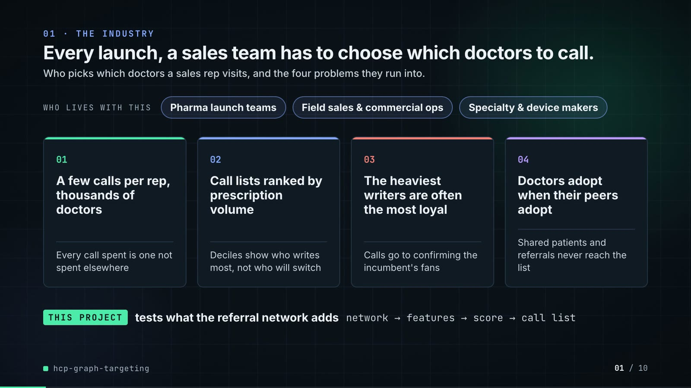

**On-screen text (verbatim)**

> 01 · THE INDUSTRY  
> Every launch, a sales team has to choose which doctors to call.  
> Who picks which doctors a sales rep visits, and the four problems they run into.  
> WHO LIVES WITH THIS · Pharma launch teams · Field sales & commercial ops · Specialty & device makers  
> 01 A few calls per rep, thousands of doctors — Every call spent is one not spent elsewhere  
> 02 Call lists ranked by prescription volume — Deciles show who writes most, not who will switch  
> 03 The heaviest writers are often the most loyal — Calls go to confirming the incumbent's fans  
> 04 Doctors adopt when their peers adopt — Shared patients and referrals never reach the list  
> THIS PROJECT tests what the referral network adds · network → features → score → call list  

**Figures on this slide**

| ID | Shown | Source · key | Calculation | Check |
|---|---|---|---|---|
| F-01 | 3 industry chips | `author's framing` · - | - | manual |
| F-02 | 4 problem cards | `README 'The problem'` · README lines 11-26 | - | ✓ |

**Assumptions:** A-12

**Illustrative, not data:**

- The whole slide is context; no repo figures.

**To change this slide:** Edit the subtitle (#ctx-sub), chips (#ctx-c1..3) and cards (#ctx-k1..4) in compositions/s01-context.html. (project folder `docs/demo/source`).

### Slide 02: This project  
*6.8-12.0 s · composition `compositions/s02-hook.html`*

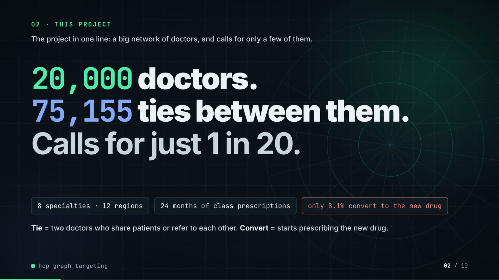

**On-screen text (verbatim)**

> 02 · THIS PROJECT  
> The project in one line: a big network of doctors, and calls for only a few of them.  
> 20,000 doctors. 75,155 ties between them. Calls for just 1 in 20.  
> 8 specialties · 12 regions · 24 months of class prescriptions · only 8.1% convert to the new drug  
> Tie = two doctors who share patients or refer to each other. Convert = starts prescribing the new drug.  

**Figures on this slide**

| ID | Shown | Source · key | Calculation | Check |
|---|---|---|---|---|
| F-03 | 20,000 doctors / 20,000 HCPs | `outputs/summary.json` · n_hcps | - | ✓ |
| F-04 | 75,155 ties | `outputs/summary.json; data/edges.csv` · n_edges | - | ✓ |
| F-05 | Calls for just 1 in 20 | `outputs/summary.json` · budgets.captured_5pct = 1,000; n_hcps = 20,000 | 20,000 / 1,000 = 20 | ✓ |
| F-06 | 8 specialties · 12 regions | `data/hcps.csv` · specialty, region (distinct values) | - | ✓ |
| F-07 | 24 months of class prescriptions | `data/monthly_class_rx.csv` · month columns (2024-07..2026-06) | columns - hcp_id | ✓ |
| F-08 | only 8.1% convert to the new drug / all 20,000: 8.1% | `outputs/summary.json` · conversion_rate = 0.08085 (1,617 of 20,000) | rounded to 1 decimal | ✓ |

**Assumptions:** A-01, A-03

**Illustrative, not data:**

- Rings in the background are decoration.

**To change this slide:** Headline spans #hook-l1..l3, chips #hook-f1..f3 and the definitions line #hook-def in compositions/s02-hook.html. (project folder `docs/demo/source`).

### Slide 03: How it works (white chapter, slide A)  
*11.7-19.1 s · composition `compositions/explainer.html (CONFIG.blocks, CONFIG.groups, CONFIG.loop)`*

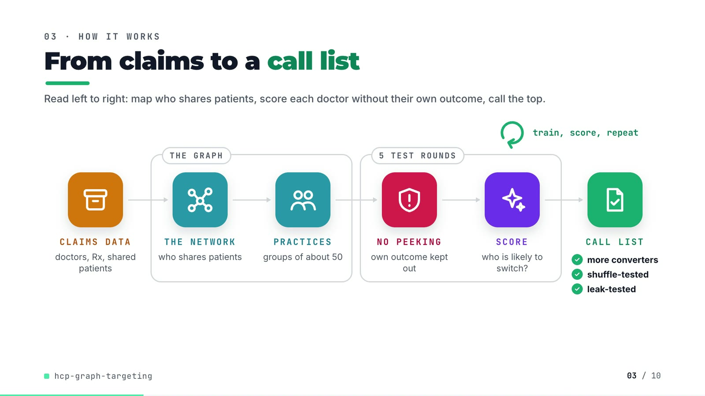

**On-screen text (verbatim)**

> 03 · HOW IT WORKS  
> From claims to a call list  
> Read left to right: map who shares patients, score each doctor without their own outcome, call the top.  
> CLAIMS DATA doctors, Rx, shared patients → [THE GRAPH: THE NETWORK who shares patients → PRACTICES groups of about 50] → [5 TEST ROUNDS: NO PEEKING own outcome kept out → SCORE who is likely to switch?] → CALL LIST ✓ more converters ✓ shuffle-tested ✓ leak-tested  
> train, score, repeat (loop over the scoring step)  

**Figures on this slide**

| ID | Shown | Source · key | Calculation | Check |
|---|---|---|---|---|
| F-09 | PRACTICES · groups of about 50 | `outputs/summary.json; README line 161` · communities_per_level[1] = 408 | 20,000 / 408 = 49 | ✓ |
| F-10 | 5 TEST ROUNDS / 5 test rounds / the model is tested 5 times | `outputs/summary.json` · folds | - | ✓ |
| F-11 | more converters · shuffle-tested · leak-tested | `outputs/ablation.csv; tests/test_leakage.py` · captured_5pct graph features > decile list; control rows present; leakage tests exist | 189 > 126 | ✓ |

**Assumptions:** A-04, A-05, A-08

**Illustrative, not data:**

- Icons and colours are a visual language, not data.
- 'Claims data' describes where shared-patient ties come from in practice; the repo's data is generated (A-01).
- 'Test round' is the plain-words name for one of the 5 cross-validation folds.

**To change this slide:** Edit CONFIG and #ex-a-sub in compositions/explainer.html; badge truth is F-11. (project folder `docs/demo/source`).

### Slide 04: The key idea (white chapter, slide B)  
*19.1-26.7 s · composition `compositions/explainer.html (#ex-b ...)`*

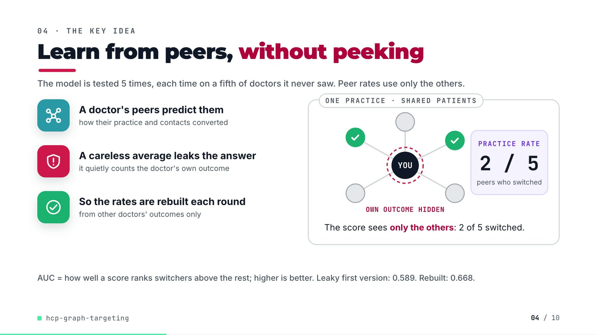

**On-screen text (verbatim)**

> 04 · THE KEY IDEA  
> Learn from peers, without peeking  
> The model is tested 5 times, each time on a fifth of doctors it never saw. Peer rates use only the others.  
> A doctor's peers predict them — how their practice and contacts converted  
> A careless average leaks the answer — it quietly counts the doctor's own outcome  
> So the rates are rebuilt each round — from other doctors' outcomes only  
> ONE PRACTICE · SHARED PATIENTS: YOU + 5 peers, OWN OUTCOME HIDDEN, PRACTICE RATE 2 / 5 peers who switched. The score sees only the others: 2 of 5 switched.  
> AUC = how well a score ranks switchers above the rest; higher is better. Leaky first version: 0.589. Rebuilt: 0.668.  

**Figures on this slide**

| ID | Shown | Source · key | Calculation | Check |
|---|---|---|---|---|
| F-12 | Leaky first version: 0.589 | `docs/adr/0001-graph-features-built-fold-safe-embeddings-label-free.md:17` · ADR text | - | ✓ |
| F-13 | 0.668 | `outputs/ablation.csv` · arm='+ community and neighbour conversion rates', auc | - | ✓ |
| F-15 | PRACTICE RATE 2 / 5 | `schematic` · - | - | manual |
| F-63 | AUC = how well a score ranks converters (switchers) above the rest; higher is better; 0.5 = a coin flip | `standard definition of ROC AUC` · - | - | manual |

**Assumptions:** A-04, A-07

**Illustrative, not data:**

- The YOU + 5 peers demo is schematic (F-15); it mirrors label_graph_features, not real HCPs.

**To change this slide:** Markup under #ex-b and the practice demo block in compositions/explainer.html; the footnote figures are F-12, F-13, F-63. (project folder `docs/demo/source`).

### Slide 05: Architecture  
*26.4-42.4 s · composition `compositions/s03-architecture.html`*

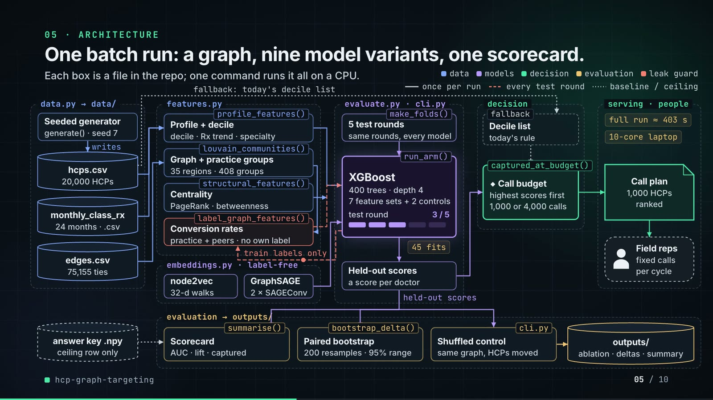

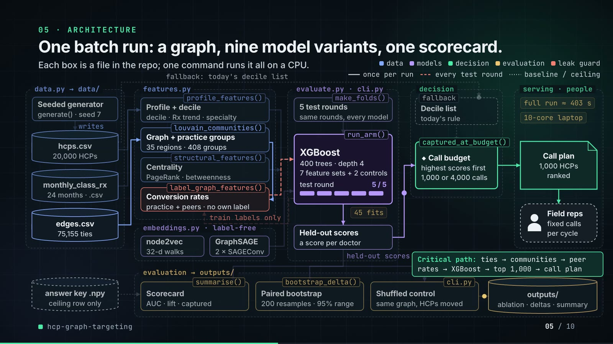

**On-screen text (verbatim)**

> 05 · ARCHITECTURE  
> One batch run: a graph, nine model variants, one scorecard.  
> Each box is a file in the repo; one command runs it all on a CPU.  
> Legend: data · models · decision · evaluation · leak guard; once per run · every test round · baseline / ceiling  
> data.py → data/: Seeded generator (generate() · seed 7) writes hcps.csv (20,000 HCPs), monthly_class_rx (24 months · .csv), edges.csv (75,155 ties); answer key .npy (ceiling row only)  
> features.py: profile_features() Profile + decile (decile · Rx trend · specialty); louvain_communities() Graph + practice groups (35 regions · 408 groups); structural_features() Centrality (PageRank · betweenness); label_graph_features() Conversion rates (practice + peers · no own label)  
> embeddings.py · label-free: node2vec (32-d walks), GraphSAGE (2 × SAGEConv)  
> evaluate.py · cli.py: make_folds() 5 test rounds (same rounds, every model) → run_arm() XGBoost (400 trees · depth 4 · 7 feature sets + 2 controls · test round n / 5) → Held-out scores (a score per doctor); 45 fits; feedback loop 'train labels only' back to Conversion rates  
> decision: fallback Decile list (today's rule) → captured_at_budget() ◆ Call budget (highest scores first · 1,000 or 4,000 calls)  
> serving · people: Call plan (1,000 HCPs ranked) → Field reps (fixed calls per cycle); notes: full run ≈ 403 s · 10-core laptop  
> evaluation → outputs/: summarise() Scorecard (AUC · lift · captured), bootstrap_delta() Paired bootstrap (200 resamples · 95% range), cli.py Shuffled control (same graph, HCPs moved) → outputs/ (ablation · deltas · summary)  
> Edge labels: writes · train labels only · fallback: today's decile list · held-out scores  
> Critical path: ties → communities → peer rates → XGBoost → top 1,000 → call plan  

**Figures on this slide**

| ID | Shown | Source · key | Calculation | Check |
|---|---|---|---|---|
| F-03 | 20,000 doctors / 20,000 HCPs | `outputs/summary.json` · n_hcps | - | ✓ |
| F-04 | 75,155 ties | `outputs/summary.json; data/edges.csv` · n_edges | - | ✓ |
| F-07 | 24 months of class prescriptions | `data/monthly_class_rx.csv` · month columns (2024-07..2026-06) | columns - hcp_id | ✓ |
| F-10 | 5 TEST ROUNDS / 5 test rounds / the model is tested 5 times | `outputs/summary.json` · folds | - | ✓ |
| F-16 | generate(), profile_features(), louvain_communities(), structural_features(), label_graph_features(), node2vec, GraphSAGE, make_folds(), run_arm(), captured_at_budget(), summarise(), bootstrap_delta(), cli.py shuffled control | `src/hcp_targeting/` · def names | - | ✓ |
| F-17 | 35 regions · 408 groups | `outputs/summary.json` · communities_per_level | - | ✓ |
| F-19 | 400 trees · depth 4 | `src/hcp_targeting/evaluate.py:88-90` · n_estimators, max_depth | - | ✓ |
| F-20 | nine model variants · 7 feature sets + 2 controls · 45 fits | `src/hcp_targeting/evaluate.py (ARMS); cli.py:98 (ARMS[2], ARMS[5]); outputs/ablation.csv` · 7 Arm(...) + 2 control rows | (7 + 2) x 5 folds = 45 | ✓ |
| F-21 | 32-d walks · 2 × SAGEConv | `src/hcp_targeting/cli.py:197; embeddings.py:131-133` · --dim 32; conv1, conv2 = SAGEConv | - | ✓ |
| F-22 | 1,000 or 4,000 calls | `outputs/summary.json` · budgets | - | ✓ |
| F-23 | 200 resamples · 95% range / 95% ranges from 200 resamples | `src/hcp_targeting/cli.py:201; evaluate.py:52` · --n-boot default 200; percentiles 2.5/97.5 | - | ✓ |
| F-24 | full run ≈ 403 s · 10-core laptop | `README line 178` · README text | - | ✓ |
| F-25 | one command runs it all on a CPU / RUNS ON A LAPTOP CPU | `README 'Running it'` · README text | - | ✓ |
| F-26 | fallback: today's decile list | `src/hcp_targeting/cli.py:83-84` · rule = decile * 1e6 + annual_class_rx | - | ✓ |
| F-27 | practice + peers · no own label · train labels only | `src/hcp_targeting/features.py:153-184; tests/test_leakage.py` · inner_folds = 5 | - | ✓ |
| F-28 | generate() · seed 7 | `outputs/summary.json` · seed | - | ✓ |

- *F-20 note:* 7 arms: T().count('    Arm(') counts the seven entries of ARMS (the dataclass definition line is 'class Arm:').
- *F-24 note:* README states this for an earlier session; the captured run in outputs/ took 12,279 s (3.4 h) on a shared machine (summary.json runtime_seconds).

**Assumptions:** A-01, A-03, A-04, A-05, A-06, A-07, A-08, A-09

**Illustrative, not data:**

- Packets moving along the edges follow execution order but their speed is decorative; the round counter shows the 5 folds, not wall-clock time.
- 'Field reps · fixed calls per cycle' is the human-in-the-loop consumer from the README problem statement; the repo has no rep or scheduling code.
- 'Call plan' is the top 1,000 of the out-of-fold scores (what captured_at_budget counts); the repo does not write a plan file — the demo's export script does (slide 07).
- During the critical-path phase the other boxes dim to 75% opacity (text stays above 4.5:1 contrast).

**To change this slide:** FRAMES, N (components) and W (edges) objects in compositions/s03-architecture.html. (project folder `docs/demo/source`).

### Slide 06: The system running  
*42.0-56.6 s · composition `compositions/s04-routes.html (NET block injected by tools/inject_sheet.py; LADDER array)`*

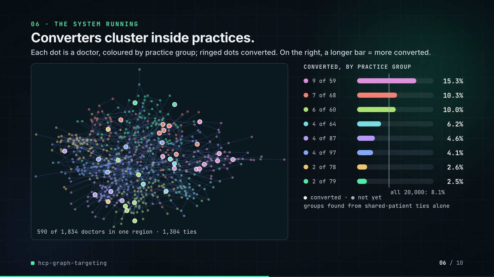

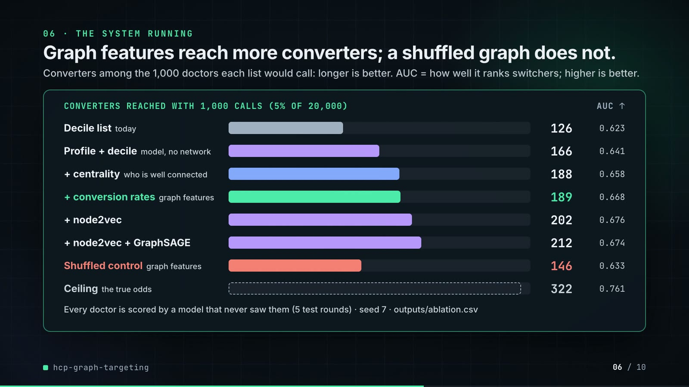

**On-screen text (verbatim)**

> 06 · THE SYSTEM RUNNING  
> Phase A: Converters cluster inside practices.  
> Each dot is a doctor, coloured by practice group; ringed dots converted. On the right, a longer bar = more converted.  
> Network panel: 590 of 1,834 doctors in one region · 1,304 ties  
> CONVERTED, BY PRACTICE GROUP: 9 of 59 15.3% · 7 of 68 10.3% · 6 of 60 10.0% · 4 of 64 6.2% · 4 of 87 4.6% · 4 of 97 4.1% · 2 of 78 2.6% · 2 of 79 2.5% · all 20,000: 8.1%  
> ● converted · ● not yet · groups found from shared-patient ties alone  
> Phase B: Graph features reach more converters; a shuffled graph does not.  
> Converters among the 1,000 doctors each list would call: longer is better. AUC = how well it ranks switchers; higher is better.  
> CONVERTERS REACHED WITH 1,000 CALLS (5% OF 20,000) · AUC ↑: Decile list today 126 0.623 · Profile + decile (model, no network) 166 0.641 · + centrality (who is well connected) 188 0.658 · + conversion rates (graph features) 189 0.668 · + node2vec 202 0.676 · + node2vec + GraphSAGE 212 0.674 · Shuffled control (graph features) 146 0.633 · Ceiling (the true odds) 322 0.761  
> Every doctor is scored by a model that never saw them (5 test rounds) · seed 7 · outputs/ablation.csv  

**Figures on this slide**

| ID | Shown | Source · key | Calculation | Check |
|---|---|---|---|---|
| F-08 | only 8.1% convert to the new drug / all 20,000: 8.1% | `outputs/summary.json` · conversion_rate = 0.08085 (1,617 of 20,000) | rounded to 1 decimal | ✓ |
| F-29 | 590 of 1,834 doctors in one region · 1,304 ties | `demo assets/call_plan.json (network_sample), exported by tools/export_call_plan.py from Louvain on data/edges.csv` · len(nodes), l0_size, len(edges) | 8 largest level-1 communities of the 5th-largest level-0 block | ✓ |
| F-30 | 9 of 59 15.3% · 7 of 68 10.3% · 6 of 60 10.0% · 4 of 64 6.2% · 4 of 87 4.6% · 4 of 97 4.1% · 2 of 78 2.6% · 2 of 79 2.5% | `demo assets/call_plan.json (network_sample.communities); labels from data/hcps.csv converted` · converted, size, rate | rate = converted / size | ✓ |
| F-31 | ● converted · ● not yet | `data/hcps.csv; demo assets/call_plan.json` · converted per hcp_id | - | ✓ |
| F-32 | 126 · 0.623 | `outputs/ablation.csv` · arm='decile list (no model)': captured_5pct, auc | - | ✓ |
| F-33 | 166 · 0.641 | `outputs/ablation.csv` · captured_5pct, auc | - | ✓ |
| F-34 | 188 · 0.658 | `outputs/ablation.csv` · captured_5pct, auc | - | ✓ |
| F-35 | 189 · 0.668 | `outputs/ablation.csv` · captured_5pct, auc | - | ✓ |
| F-36 | 202 · 0.676 | `outputs/ablation.csv` · captured_5pct, auc | - | ✓ |
| F-37 | 212 · 0.674 | `outputs/ablation.csv` · captured_5pct, auc | - | ✓ |
| F-38 | 146 · 0.633 | `outputs/ablation.csv` · arm='control, HCPs shuffled across the graph: + community and neighbour conversion rates' | - | ✓ |
| F-39 | 322 · 0.761 | `outputs/ablation.csv` · arm='ceiling: true propensity (answer key)' | - | ✓ |
| F-63 | AUC = how well a score ranks converters (switchers) above the rest; higher is better; 0.5 = a coin flip | `standard definition of ROC AUC` · - | - | manual |

- *F-30 note:* Counts are over the whole level-1 community. One community (6 of 60) has 2 members outside the sampled regional block, so the panel draws 58 of its 60 HCPs; all 6 converters are inside. Node labels are re-checked against data/hcps.csv by sample_labels_match() (F-31).

**Assumptions:** A-02, A-03, A-05, A-07, A-08, A-09

**Illustrative, not data:**

- The network layout is a seeded spring layout (networkx, seed 7) of the real sampled subgraph; position has no meaning beyond tie structure.
- Practice-group colours are arbitrary; groups are the level-1 Louvain communities.
- Bar lengths: 860 px track = 340 converters.
- Phase A fades fully out before phase B's title appears.

**To change this slide:** Re-run tools/export_call_plan.py + tools/inject_sheet.py for the network panel; LADDER array and #routes-title-b / #routes-sub-b in compositions/s04-routes.html for the ladder. (project folder `docs/demo/source`).

### Slide 07: End-user value (white)  
*56.3-69.3 s · composition `compositions/value.html (SHEET block injected by tools/inject_sheet.py)`*

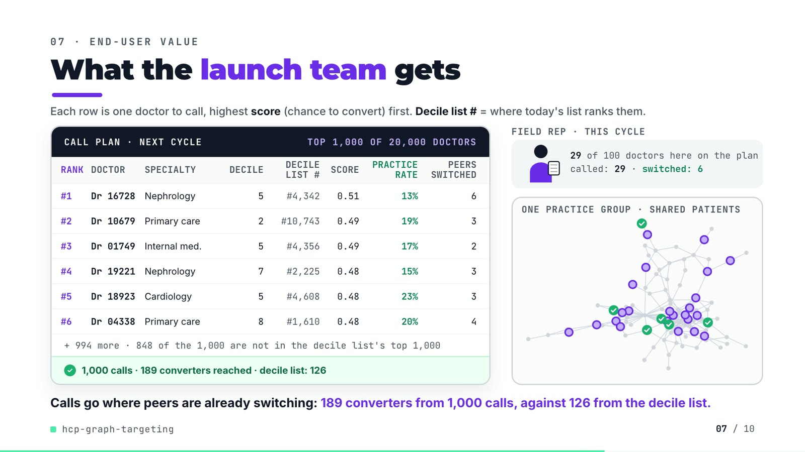

**On-screen text (verbatim)**

> 07 · END-USER VALUE  
> What the launch team gets  
> Each row is one doctor to call, highest score (chance to convert) first. Decile list # = where today's list ranks them.  
> CALL PLAN · NEXT CYCLE · TOP 1,000 OF 20,000 DOCTORS — columns RANK, DOCTOR, SPECIALTY, DECILE, DECILE LIST #, SCORE, PRACTICE RATE, PEERS SWITCHED  
> #1 Dr 16728 Nephrology 5 #4,342 0.51 13% 6  
> #2 Dr 10679 Primary care 2 #10,743 0.49 19% 3  
> #3 Dr 01749 Internal med. 5 #4,356 0.49 17% 2  
> #4 Dr 19221 Nephrology 7 #2,225 0.48 15% 3  
> #5 Dr 18923 Cardiology 5 #4,608 0.48 23% 3  
> #6 Dr 04338 Primary care 8 #1,610 0.48 20% 4  
> + 994 more · 848 of the 1,000 are not in the decile list's top 1,000  
> ✓ 1,000 calls · 189 converters reached · decile list: 126  
> FIELD REP · THIS CYCLE: 29 of 100 doctors here on the plan · called: 29 · switched: 6  
> ONE PRACTICE GROUP · SHARED PATIENTS  
> Calls go where peers are already switching: 189 converters from 1,000 calls, against 126 from the decile list.  

**Figures on this slide**

| ID | Shown | Source · key | Calculation | Check |
|---|---|---|---|---|
| F-03 | 20,000 doctors / 20,000 HCPs | `outputs/summary.json` · n_hcps | - | ✓ |
| F-40 | #1 Dr 16728 … #6 Dr 04338 | `demo assets/call_plan.json, injected into compositions/value.html` · plan ranks 1-6 | score = out-of-fold p(convert); practice rate = fold-built community_conv_rate_l1 as the HCP saw it when held out; PEERS SWITCHED = nbr_converted | ✓ |
| F-41 | + 994 more | `demo assets/call_plan.json` · calls - 6 rows | 1,000 - 6 = 994 | ✓ |
| F-42 | 848 of the 1,000 are not in the decile list's top 1,000 | `demo assets/call_plan.json` · plan[].decile_rank > 1,000 | count | ✓ |
| F-43 | 1,000 calls · 189 converters reached · decile list: 126 | `demo assets/call_plan.json; outputs/ablation.csv` · captured, captured_decile_list (equal to ablation.csv captured_5pct) | - | ✓ |
| F-44 | 29 of 100 doctors here on the plan · called: 29 · switched: 6 | `demo assets/call_plan.json (scene)` · size, planned, planned_converted | - | ✓ |
| F-45 | TOP 1,000 OF 20,000 DOCTORS | `demo assets/call_plan.json` · calls, n_hcps | - | ✓ |

**Assumptions:** A-02, A-03, A-04, A-10

**Illustrative, not data:**

- 'Dr' numbers are the generator's synthetic hcp_id values (no real people).
- 'NEXT CYCLE' frames the out-of-fold ranking as a plan; in the repo the scores and outcomes come from the same campaign window (README 'Known limitations': static snapshot).
- The rep figure, call cards and their timing are illustrative; the community (level-1 community 8), its ties, which members are on the plan and which converted are real, laid out with a seeded spring layout.
- Practice rate is the smoothed fold-built community conversion rate (prior weight 20), so it is not a raw share.
- The region column was dropped from the sheet for width; the rows' regions are still checked against data/hcps.csv (F-40).

**To change this slide:** Re-run tools/export_call_plan.py, then tools/inject_sheet.py (--rows picks the plan ranks); layout in compositions/value.html. (project folder `docs/demo/source`).

### Slide 08: Results  
*69.0-77.8 s · composition `compositions/s05-results.html (stats array)`*

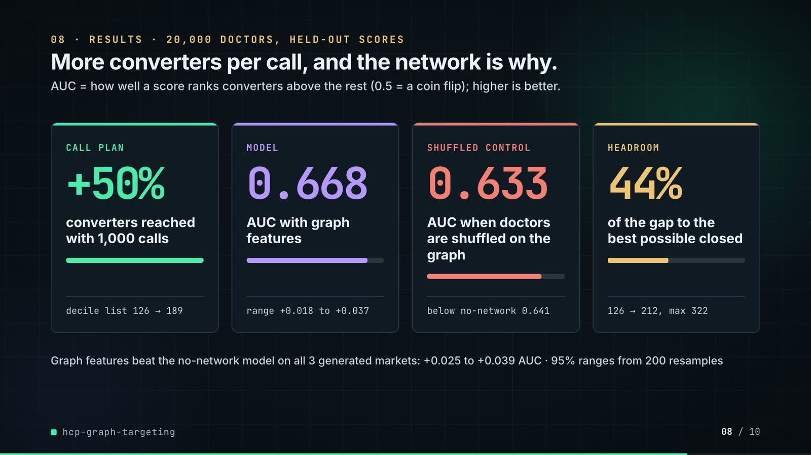

**On-screen text (verbatim)**

> 08 · RESULTS · 20,000 DOCTORS, HELD-OUT SCORES  
> More converters per call, and the network is why.  
> AUC = how well a score ranks converters above the rest (0.5 = a coin flip); higher is better.  
> CALL PLAN +50% converters reached with 1,000 calls · decile list 126 → 189  
> MODEL 0.668 AUC with graph features · range +0.018 to +0.037  
> SHUFFLED CONTROL 0.633 AUC when doctors are shuffled on the graph · below no-network 0.641  
> HEADROOM 44% of the gap to the best possible closed · 126 → 212, max 322  
> Graph features beat the no-network model on all 3 generated markets: +0.025 to +0.039 AUC · 95% ranges from 200 resamples  

**Figures on this slide**

| ID | Shown | Source · key | Calculation | Check |
|---|---|---|---|---|
| F-13 | 0.668 | `outputs/ablation.csv` · arm='+ community and neighbour conversion rates', auc | - | ✓ |
| F-23 | 200 resamples · 95% range / 95% ranges from 200 resamples | `src/hcp_targeting/cli.py:201; evaluate.py:52` · --n-boot default 200; percentiles 2.5/97.5 | - | ✓ |
| F-37 | 212 · 0.674 | `outputs/ablation.csv` · captured_5pct, auc | - | ✓ |
| F-38 | 146 · 0.633 | `outputs/ablation.csv` · arm='control, HCPs shuffled across the graph: + community and neighbour conversion rates' | - | ✓ |
| F-39 | 322 · 0.761 | `outputs/ablation.csv` · arm='ceiling: true propensity (answer key)' | - | ✓ |
| F-46 | +50% · decile list 126 → 189 | `outputs/ablation.csv` · captured_5pct: graph features 189, decile list 126 | 189 / 126 - 1 = +50.0% | ✓ |
| F-47 | 0.641 → 0.668 · range +0.018 to +0.037 | `outputs/deltas.csv` · arm='+ community and neighbour conversion rates', vs='profile + decile', metric=auc | - | ✓ |
| F-48 | 0.633 · below no-network 0.641 | `outputs/ablation.csv` · both control rows auc; profile + decile auc | - | ✓ |
| F-49 | 44% · 126 → 212, max 322 | `outputs/ablation.csv` · captured_5pct: decile 126, best (n2v + SAGE) 212, ceiling 322 | (212 - 126) / (322 - 126) = 43.9% | ✓ |
| F-50 | +0.025 to +0.039 AUC | `outputs/seed_sweep.csv` · auc: 'graph features' minus 'profile' per seed (7, 11, 23) | min/max of 0.0269, 0.0247, 0.0388 | ✓ |
| F-63 | AUC = how well a score ranks converters (switchers) above the rest; higher is better; 0.5 = a coin flip | `standard definition of ROC AUC` · - | - | manual |

**Assumptions:** A-02, A-03, A-07, A-08, A-09, A-11

**Illustrative, not data:**

- Mini bars: card 1 and 4 are drawn to the ratio shown; cards 2-3 are AUC / 0.761 (ceiling).

**To change this slide:** The stats array and card text in compositions/s05-results.html. (project folder `docs/demo/source`).

### Slide 09: Lesson and fix  
*77.4-86.4 s · composition `compositions/s06-twist.html`*

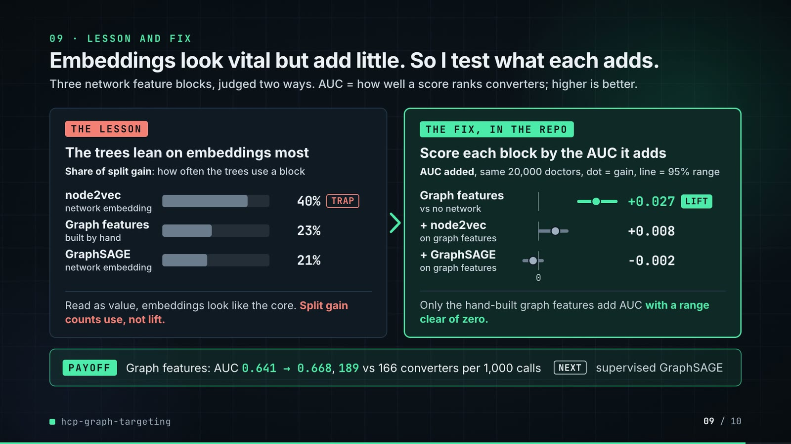

**On-screen text (verbatim)**

> 09 · LESSON AND FIX  
> Embeddings look vital but add little. So I test what each adds.  
> Three network feature blocks, judged two ways. AUC = how well a score ranks converters; higher is better.  
> THE LESSON · The trees lean on embeddings most · Share of split gain: how often the trees use a block · node2vec (network embedding) 40% TRAP · Graph features (built by hand) 23% · GraphSAGE (network embedding) 21%  
> Read as value, embeddings look like the core. Split gain counts use, not lift.  
> THE FIX, IN THE REPO · Score each block by the AUC it adds · AUC added, same 20,000 doctors, dot = gain, line = 95% range · Graph features (vs no network) +0.027 LIFT · + node2vec (on graph features) +0.008 · + GraphSAGE (on graph features) -0.002  
> Only the hand-built graph features add AUC with a range clear of zero.  
> PAYOFF · Graph features: AUC 0.641 → 0.668, 189 vs 166 converters per 1,000 calls · NEXT supervised GraphSAGE  

**Figures on this slide**

| ID | Shown | Source · key | Calculation | Check |
|---|---|---|---|---|
| F-51 | Graph features vs no network +0.027 (line +0.018 to +0.037) LIFT | `outputs/deltas.csv` · arm='+ community and neighbour conversion rates', vs='profile + decile', auc | - | ✓ |
| F-52 | +0.008 (range touches zero) | `outputs/deltas.csv` · arm='graph features + node2vec', vs='graph features', auc | - | ✓ |
| F-53 | -0.002 | `outputs/deltas.csv` · arm='graph features + GraphSAGE', vs='graph features', auc | - | ✓ |
| F-56 | 40% TRAP · 23% · 21% | `outputs/summary.json` · gain_share_by_block_full_model: node2vec 0.3975, structure 0.1259 + label_graph 0.1049, graphsage 0.2091 | graph features = 0.1259 + 0.1049 = 0.2309 | ✓ |
| F-60 | AUC 0.641 → 0.668, 189 vs 166 converters per 1,000 calls | `outputs/ablation.csv` · auc and captured_5pct: profile + decile (XGBoost), + community and neighbour conversion rates | - | ✓ |
| F-61 | THE FIX, IN THE REPO · Score each block by the AUC it adds | `src/hcp_targeting/cli.py:123-150 (deltas loop, bootstrap_delta); src/hcp_targeting/evaluate.py (bootstrap_delta)` · ref_name in ('profile + decile', 'graph features'); deltas.csv written | - | ✓ |
| F-62 | NEXT supervised GraphSAGE | `README 'Insights and learning'; README 'Design decisions' (leaves a fold-safe supervised GraphSAGE untested)` · README text | - | ✓ |
| F-63 | AUC = how well a score ranks converters (switchers) above the rest; higher is better; 0.5 = a coin flip | `standard definition of ROC AUC` · - | - | manual |

- *F-52 note:* ci_low = -0.000135, so the range just reaches below zero; the slide says only graph features have a range clear of zero.
- *F-53 note:* delta = -0.00249; the README rounds it to -0.003, the video shows -0.002 (3-decimal rounding of the CSV value).

**Assumptions:** A-02, A-04, A-07, A-11

**Illustrative, not data:**

- Left bars: 260 px = 50% split-gain share. Right: a forest plot, 260 px = -0.01 to +0.04 AUC, zero marked; dots are point estimates, lines the 95% paired-bootstrap ranges. The two panels use different units, so they cannot share one bar scale.
- Colour meaning: neutral grey for every compared block, coral only for the TRAP label and lesson tag, mint for the fix panel and the one block whose lift clears zero.
- 'NEXT' is a step the README proposes, not something the repo does (F-62).

**To change this slide:** Panels #twist-left / #twist-right (bar widths, interval left/width and dot positions are inline styles on #twist-lb1..3, #twist-rb1..3, #twist-rp1..3) and #twist-payoff in compositions/s06-twist.html. (project folder `docs/demo/source`).

### Slide 10: End card  
*86.0-90.4 s · composition `compositions/s07-end.html`*

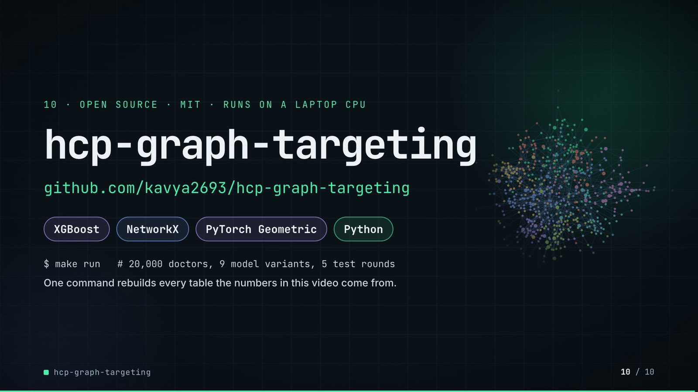

**On-screen text (verbatim)**

> 10 · OPEN SOURCE · MIT · RUNS ON A LAPTOP CPU  
> hcp-graph-targeting  
> github.com/kavya2693/hcp-graph-targeting  
> XGBoost · NetworkX · PyTorch Geometric · Python  
> $ make run   # 20,000 doctors, 9 model variants, 5 test rounds  
> One command rebuilds every table the numbers in this video come from.  

**Figures on this slide**

| ID | Shown | Source · key | Calculation | Check |
|---|---|---|---|---|
| F-03 | 20,000 doctors / 20,000 HCPs | `outputs/summary.json` · n_hcps | - | ✓ |
| F-25 | one command runs it all on a CPU / RUNS ON A LAPTOP CPU | `README 'Running it'` · README text | - | ✓ |
| F-57 | MIT | `LICENSE line 1` · - | - | ✓ |
| F-58 | XGBoost · NetworkX · PyTorch Geometric · Python | `pyproject.toml dependencies` · xgboost, networkx, torch-geometric | - | ✓ |
| F-59 | $ make run   # 20,000 doctors, 9 model variants, 5 test rounds | `Makefile; cli.py defaults` · run target; --n-hcps 20000; 7 arms + 2 controls; --folds 5 | - | ✓ |

**Assumptions:** A-11

**Illustrative, not data:**

- Faded network in the background is the slide 06 sample.

**To change this slide:** Text in compositions/s07-end.html. (project folder `docs/demo/source`).

## 5. Change-impact matrix

| Input / assumption | Affected figures | Affected slides | Files to edit | Commands to re-run |
|---|---|---|---|---|
| A-01: All data is synthetic, produced by a seeded generator (20,000 HCPs, 8 specialties, 12 regions, about 440 practice groups, 24 months of class prescriptions, 75,155 ties) | all figures | 01, 02, 03, 04, 05, 06, 07, 08, 09, 10 | `src/hcp_targeting/data.py; scripts/generate_data.py` | `make data; make run; export_call_plan.py + inject_sheet.py` |
| A-02: The generator decides how much the network matters: conversion depends on hidden practice-group culture (sd 0 | F-13, F-29, F-30, F-32, F-33, F-34, F-35, F-36, F-37, F-38, F-39, F-43, F-46, F-47, F-48, F-49, F-50 | 04, 06, 07, 08 | `src/hcp_targeting/data.py:98, :188-189` | `make run; export_call_plan.py + inject_sheet.py` |
| A-03: A call budget is 5% (1,000 calls) or 20% (4,000 calls) of the 20,000 HCPs; 'converters reached' assumes the call is what converts the HCP (the model ranks propensity, not uplift from calling) | F-05, F-22, F-32, F-33, F-34, F-35, F-36, F-37, F-38, F-39, F-41, F-42, F-43, F-44, F-45, F-46, F-49 | 02, 05, 06, 07, 08 | `src/hcp_targeting/cli.py:199-200` | `make run; export_call_plan.py + inject_sheet.py` |
| A-04: Label-derived features (community and neighbour conversion rates) are rebuilt inside every outer fold from training labels only, with an inner 5-fold split and a prior weight of 20; embeddings are trained without labels | F-10, F-11, F-12, F-13, F-27, F-35, F-40 | 03, 04, 05, 06, 07, 08 | `src/hcp_targeting/features.py:153-184; src/hcp_targeting/evaluate.py:129 (prior_weight)` | `make run; export_call_plan.py + inject_sheet.py` |
| A-05: Louvain runs at resolution 1 (regional blocks) and 16 (practice-size communities); 16 was chosen to match practice size, not tuned on conversion | F-09, F-17, F-29, F-30, F-44 | 03, 05, 06, 07 | `src/hcp_targeting/features.py:60` | `make run; export_call_plan.py + inject_sheet.py` |
| A-06: Betweenness is estimated from 256 sampled sources (64 in the seed sweep) | F-50 | 08 | `src/hcp_targeting/cli.py:198` | `make run` |
| A-07: Every arm uses one XGBoost setting (400 trees, depth 4, learning rate 0 | F-13, F-19, F-20, F-32, F-33, F-34, F-35, F-36, F-37, F-38, F-39, F-46, F-47, F-48 | 04, 05, 06, 08 | `src/hcp_targeting/evaluate.py:85-98` | `make run; export_call_plan.py + inject_sheet.py` |
| A-08: The shuffled-graph control moves every HCP to a random node of the same graph (seed 8 permutation): structure is unchanged, the person-position link is broken | F-11, F-38, F-48 | 03, 06, 08 | `src/hcp_targeting/cli.py:93-104` | `make run` |
| A-09: The ceiling row scores HCPs by the generator's true propensity (answer key), which no feature reads | F-39, F-49 | 06, 08 | `src/hcp_targeting/data.py` | `make run` |
| A-10: The call plan on slide 07 ranks the arm '+ community and neighbour conversion rates' (hand-built graph features, no embeddings) by its out-of-fold scores; the demo's export re-runs that arm and asserts AUC 0 | F-40, F-41, F-42, F-43, F-44, F-45 | 07 | `docs/demo/source/tools/export_call_plan.py (arm, CALLS)` | `export_call_plan.py + inject_sheet.py; hyperframes render` |
| A-11: Video rounding: AUC to 3 decimals, AUC deltas to 3 decimals with sign, percentages to 1 decimal (community rates, 8 | F-05, F-08, F-30, F-46, F-49, F-50, F-51, F-52, F-53, F-56, F-60 | 02, 06, 08, 09 | `the composition file named on each slide` | `hyperframes render` |
| A-12: Slide 01 (industry, everyday problems) is general pharma-commercial knowledge used as context, consistent with README 'The problem' | F-01, F-02 | 01 | `compositions/s01-context.html` | `hyperframes render` |

## 6. Known differences and caveats

- All results come from one generated market (seed 7, plus two sweep seeds). The generator wires practice culture and opinion-leader exposure into conversion, so the size of the graph lift is set by the generator, not measured on a real market (README 'Known limitations', A-02).
- 'Converters reached' ranks propensity, not uplift from calling: there is no call response model (A-03).
- Slide 07 presents out-of-fold scores as a 'next cycle' plan. In the repo the snapshot is static: the same campaign window provides labels for the fold-built features and the outcomes being scored (README 'Known limitations').
- The slide 07 plan comes from the demo's export script, which re-runs one arm of make run (same data, seed, folds and settings) and asserts AUC 0.668 and 189 / 126 captured against outputs/ablation.csv. The repo itself does not write a plan file.
- 'Full run ≈ 403 s' quotes the README for an earlier session; the captured run in outputs/ took 12,279 s on a shared machine.
- Slide 09 shows the GraphSAGE delta as -0.002 (3-decimal rounding of outputs/deltas.csv); the README text writes -0.003.
- Slide 09 (Lesson and fix) drops two embedding results the old slide showed: both embeddings on graph features (+0.005, range -0.002 to +0.012) and embeddings instead of hand-built features (-0.010 AUC, range -0.020 to -0.001, yet 213 vs 189 converters captured on seed 7, reversed on seeds 11 and 23). The README 'The result' section and outputs/deltas.csv still report both.
- Slide 09's fix is a measurement change: cli.py scores every arm by its paired-bootstrap AUC delta against profile + decile and against graph features (F-61). The repo does not remove the embeddings from any arm or ship one chosen model; the slide 07 plan uses the graph-features arm by the demo's choice (A-10). The NEXT step (supervised GraphSAGE inside each fold) is proposed in the README, not built (F-62).
- Slide 09's 'graph features built by hand' share (23%) sums the structure (12.6%) and label_graph (10.5%) blocks; the profile block (16.2%) is not shown.
- The 44% headroom figure uses the best arm (node2vec + GraphSAGE, 212); the +50% figure uses the hand-built graph-features arm (189).
- Slide 01 statements are general industry knowledge (A-12).

## Appendix: environment

- Commit: `719ffbfc4cf1d5bf57f19f9c80be25168ad972f6`
- Python: 3.11.7
- xgboost 3.2.0
- networkx 3.6.1
- torch 2.10.0
- torch_geometric 2.8.1
- sklearn 1.9.1
- pandas 3.0.6
- numpy 2.4.6
- Profile / seeds: data_seed=7, cv_folds=5, louvain_seed=7, xgboost_seed=7, bootstrap_resamples=200
- Run time: summary.json runtime_seconds = 12,278.9 s (3.4 h) for the captured make run on a shared machine; README reports 403 s for a full run on an idle 10-core laptop. The demo's export re-run of one arm took about 30 s.
